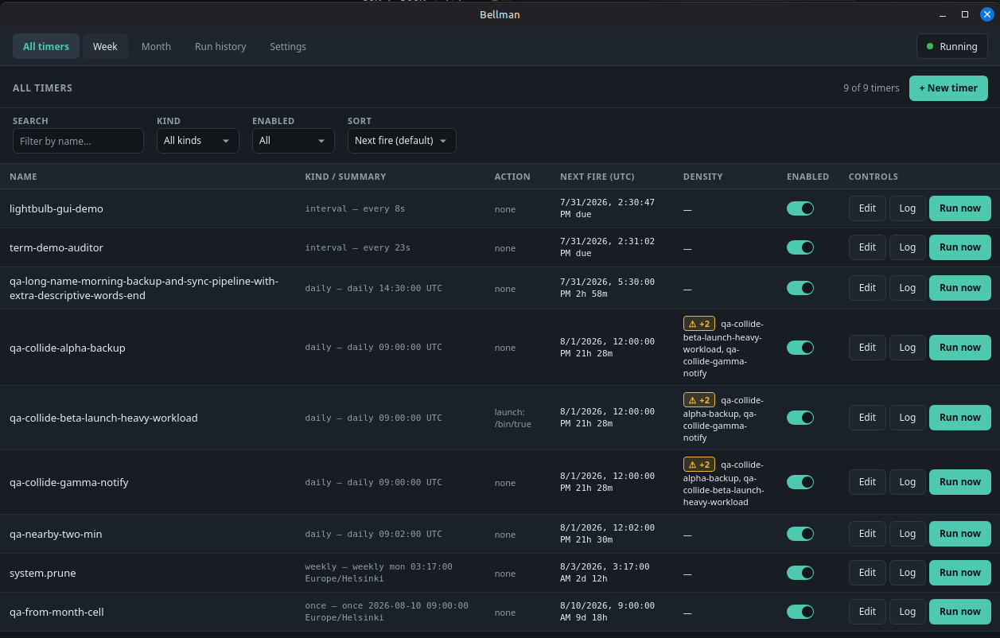
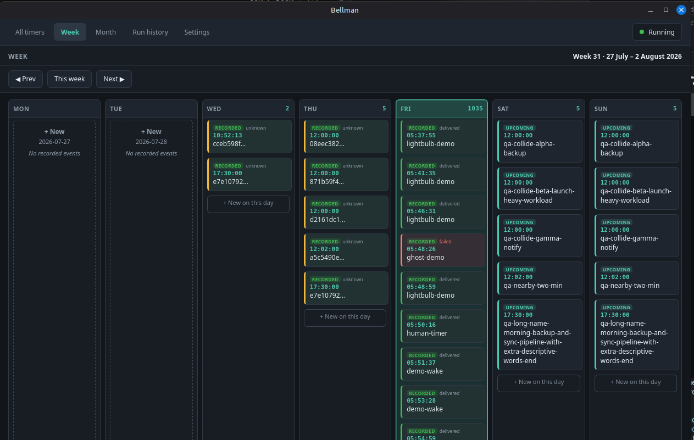
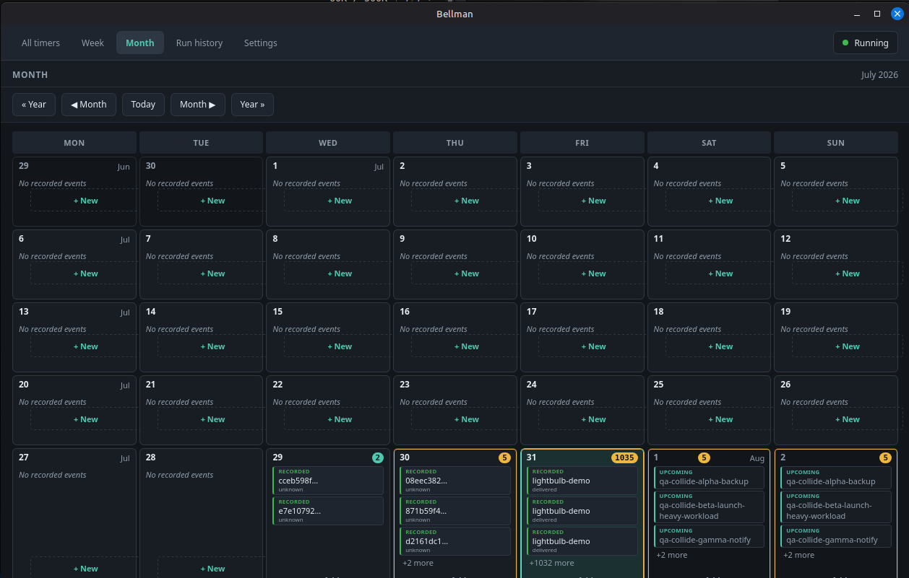
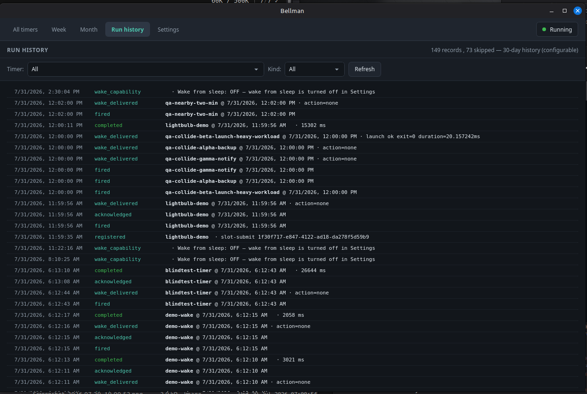

# Bellman

> ## Linux: works · Windows / macOS: not yet
>
> **On Linux, Bellman installs and runs.** Follow the [install guide](#install)
> — it is tested end to end on Ubuntu, Fedora and Arch, and on a real desktop.
>
> It is still **pre-release** (0.1.0, no tagged release, no signed packages):
> the CLI, file formats, database schema and slot protocol may still change.
> **Windows and macOS** build in CI but have not been installed or used on real
> hardware — treat them as unfinished. Progress is tracked in
> [docs/BUILD_PLAN.md](docs/BUILD_PLAN.md).

Cross-platform (Windows / macOS / Linux) **task scheduler** desktop app — the
desktop cousin of cron. Named after the bellmen (knocker-uppers) who woke
people before alarm clocks existed: Bellman's job is waking *applications*.

<p align="center">
  
</p>

<details>
<summary>More screenshots (Week · Month · Run history)</summary>

<p align="center">
  
</p>
<p align="center">
  
</p>
<p align="center">
  
</p>

All product shots live in [`docs/screenshots/`](docs/screenshots/). QA before/after captures are under [`docs/qa4-screenshots/`](docs/qa4-screenshots/).

</details>

## Install

There is no tagged release yet — you build Bellman from source. It takes six
steps and about **5 GB** of disk (2.6 GB build, ~2.5 GB toolchains).

- **Linux** (Debian/Ubuntu, Fedora, Arch) is validated — see
  [Status](#status--what-actually-exists-today).
- **Windows and macOS** packages build in CI but are unsigned and have not been
  tried on real hardware — treat them as unfinished.

**Who runs what.** Steps 1 and 5 install system packages and need `sudo`.
Steps 2–4 install into your home directory — run them as yourself, **never**
with `sudo`. Already root (a container)? Leave out `sudo`.

### 1. System packages

Debian / Ubuntu:

```sh
sudo apt update
sudo apt install -y git libwebkit2gtk-4.1-dev libgtk-3-dev build-essential \
  curl wget file libxdo-dev libssl-dev libayatana-appindicator3-dev librsvg2-dev
```

Fedora:

```sh
sudo dnf install -y git gcc gcc-c++ make webkit2gtk4.1-devel openssl-devel \
  curl wget file libxdo-devel libayatana-appindicator-gtk3-devel librsvg2-devel
```

Arch:

```sh
sudo pacman -Syu --needed git base-devel webkit2gtk-4.1 curl wget file \
  openssl xdotool libayatana-appindicator librsvg
```

`pacman -Syu` upgrades the whole system and asks before it starts; add
`--noconfirm` only for unattended runs.

Check it worked — you should see three version numbers and `step 1 OK`:

```sh
pkg-config --modversion webkit2gtk-4.1 gtk+-3.0 ayatana-appindicator3-0.1 && echo "step 1 OK"
```

### 2. Rust

```sh
curl --proto '=https' --tlsv1.2 -sSf https://sh.rustup.rs | sh -s -- -y
source "$HOME/.cargo/env"
```

### 3. Node 24 and the Tauri CLI

```sh
curl -o- https://raw.githubusercontent.com/nvm-sh/nvm/v0.39.7/install.sh | bash
source "$HOME/.nvm/nvm.sh"
nvm install 24
cargo install tauri-cli --locked
```

Any Node 24.x works, including a distro package. `cargo install` compiles the
Tauri CLI and takes a few minutes.

### 4. Get the source and build

```sh
git clone https://github.com/AccipiterTechGuy/bellman && cd bellman
cd ui && npm ci && cd ..
```

Then build for your distro (this takes several minutes):

Debian / Ubuntu:

```sh
cargo tauri build --bundles deb,appimage --ci --no-sign
```

Fedora:

```sh
cargo tauri build --bundles rpm --ci --no-sign
```

Arch:

```sh
cargo tauri build --no-bundle --ci
```

Stay in the `bellman` folder for step 5.

### 5. Install

Debian / Ubuntu:

```sh
sudo apt install -y ./target/release/bundle/deb/Bellman_*.deb
```

Fedora:

```sh
sudo dnf install -y ./target/release/bundle/rpm/Bellman-*.rpm
```

Arch:

```sh
sudo install -Dm755 -t /usr/local/bin target/release/bellman target/release/bellman-app
```

The deb and rpm add a **Bellman** entry to your app launcher; on Arch, start
the app with `bellman-app`.

### 6. Check it works

```sh
bellman --version
bellman-app --version
```

Both print `0.1.0`. Now open **Bellman** from your app launcher (Arch: run
`bellman-app`) — the first-run wizard appears. The demo apps for the
[integration guide](docs/INTEGRATION.md) are in
`/usr/share/bellman/testing_apps/` (deb/rpm) or `testing_apps/` in your clone.

### Update

From your `bellman` folder:

```sh
git pull
cd ui && npm ci && cd ..
```

Then repeat your distro's command from step 4 and from step 5. Your timers are
kept.

### Uninstall

1. If you chose **Start at login** (in the first-run wizard or Settings), turn
   it off in **Settings** first. Already uninstalled? Delete
   `~/.config/autostart/Bellman.desktop` instead.
2. Remove the program:

   Debian / Ubuntu:

   ```sh
   sudo apt remove -y bellman
   ```

   Fedora:

   ```sh
   sudo dnf remove -y bellman && sudo rm -rf /usr/share/bellman
   ```

   Arch:

   ```sh
   sudo rm -f /usr/local/bin/bellman /usr/local/bin/bellman-app
   ```

3. Optional — delete all your timers, logs and slots. **This cannot be undone:**

   ```sh
   rm -rf ~/.bellman ~/.local/share/io.bellman.desktop
   ```

   If you used `bellman task new` to write cron entries, run `crontab -e` and
   delete the block between `# BEGIN bellman-managed` and
   `# END bellman-managed`.

### Install notes

- **Arch package names.** Arch ships the `libxdo` library in the `xdotool`
  package; there is no `libxdo` package.
- **Why `libgtk-3-dev` is listed** although WebKitGTK pulls it in today: so the
  list stays complete if that dependency ever changes.
- **AppImage (Debian/Ubuntu only).** Step 4 also builds
  `target/release/bundle/appimage/Bellman_*.AppImage`, which runs without
  installing but needs FUSE 2 (`libfuse2t64` on Ubuntu 24.04). Fedora and Arch
  cannot build it: the `linuxdeploy` tool Tauri uses fails on their newer
  shared libraries, which is an upstream limitation.
- **`npm ci` warnings.** It ends with an audit summary ("12 vulnerabilities …")
  and an `esbuild` install-scripts notice. Both concern development-only
  packages that are not part of the app. Do not run `npm audit fix --force`: it
  upgrades the front-end past the tested versions.
- **What `cargo tauri build` does.** It builds the UI and the `bellman` CLI
  itself; `npm ci` is the only front-end step you run by hand.
- **Fuller checks.** On Debian/Ubuntu, `scripts/smoke_install_deb.sh` tests the
  installed package (`SMOKE_MODE=docker` runs it in a container); the manual
  VM checklist is [docs/QA_P6.md](docs/QA_P6.md).
- **How this guide is tested.** `tests/readme_install/run.sh ubuntu|fedora|arch`
  extracts every command block above from this file and runs it verbatim in a
  clean container — install, update, then uninstall — and checks that nothing
  is left behind (`--user` runs Ubuntu as a normal user with `sudo`). Last
  verified 2026-10-24 with rustc 1.99.1, tauri-cli 2.12.4 and Node 24.22.1.

Working on Bellman itself? See [Development](#development).

## What it does

**These bullets describe the intended v1 design; the
[status table](#status--what-actually-exists-today) is what actually exists
today.**

- Timers with name, time, and occurrence (once / interval / daily / weekly /
  monthly / yearly), second-level resolution, year-round calendar with automatic
  new-year recalibration.
- Two drive modes: a `bellman` CLI (AI-skill friendly) and a GUI with three
  pages — events list with next-fire times, weekly repeats, monthly calendar.
- **JSON slot-pair integration layer**: external apps register, modify, or
  delete their own wake-up timers by writing one JSON file; ≥5 empty slot pairs
  are always kept ready and auto-replenished.
- **Two-way app integration**: a woken app reports back — acknowledged,
  progress, completed or failed — over JSON files or a local socket, with an
  opt-in watchdog for apps that go quiet.
- JSONL event log with weekly pruning; memory-smart core — only near-horizon
  timers stay resident (min-heap window).

## Connect your own application

Any app, in any language, can be woken by a Bellman timer and report the
outcome back — **three JSON files and one rule: one writer per file.** No SDK,
no shared library, nothing to link against; a shell script is a valid client.
Apps that prefer a socket can speak the same messages over local IPC instead.

Start here: **[docs/INTEGRATION.md → Connect your own
application](docs/INTEGRATION.md#connect-your-own-application)** — the protocol,
what each file contains, and copy-paste clients in Python, bash, PowerShell and
Node. Two reference apps in [`testing_apps/`](testing_apps/) demonstrate the full loop: copy [`testing_apps/lightbulb/`](testing_apps/lightbulb/) (~130 lines, terminal only) into your own code, or run [`testing_apps/lightbulb_gui/`](testing_apps/lightbulb_gui/) to watch the interactive window set a time, light the golden bulb, and drive the four-step handshake.

## Your data stays yours

Bellman keeps every timer, log and slot in a per-OS data directory — **never
in this repository**. Cloning the code tells nobody what you schedule. There
are **two** data directories, one per interface:

| OS | `bellman` CLI (default) | desktop app (GUI) |
|---|---|---|
| Linux | `~/.bellman/` | `~/.local/share/io.bellman.desktop/` |
| macOS | `~/.bellman/` | `~/Library/Application Support/io.bellman.desktop/` |
| Windows | `%USERPROFILE%\.bellman\` | `%APPDATA%\io.bellman.desktop\` (Roaming) |

The GUI shows its active directory under **Settings → Data**; the CLI names its
default in `bellman --help` (override with `--db` / `BELLMAN_DB`). The
scheduler runs inside the desktop app, so a timer created with plain
`bellman add` sits in the CLI store and **nothing fires it** until something
drives that store — point the CLI at the app's directory if you want the app
to fire your timer. See [docs/LOCAL.md](docs/LOCAL.md) for the data-dir
layout and the ignored patterns for keeping private integrations out of git.

## Status — what actually exists today

**Everything below is built except the last line.** The scheduling core and the
app-integration surface are complete; what remains before a release is
validating the whole thing on real hardware.

**Core — timers, firing, history**

| phase | state |
|---|---|
| Occurrence engine (once/interval/daily/weekly/monthly/yearly/cron, DST + clamp policies) | ✅ built |
| SQLite store — timers / runs / claim ledger, WAL | ✅ built |
| Scheduler — horizon heap, chunked sleeps, clock-jump detector, misfire pass | ✅ built |
| Fire dispatcher — publication decoupled from action execution, bounded action lanes | ✅ built |
| JSONL event log — single durable publisher, `fdatasync` before publish, gzip weekly/size rotation, 30-day retention | ✅ built |
| Pruner, hardening, perf gates | ✅ built |

**App integration — waking other applications**

| phase | state |
|---|---|
| Slot channel — apps create / modify / delete their own timers by writing one JSON file | ✅ built |
| Per-timer folder tree — `timer.json`, `status.json`, human-browsable, rebuildable | ✅ built |
| Reply channel — per-run reply file, at-least-once delivery, pickup grace, late-reply revision | ✅ built |
| Opt-in silence watchdog — `error_detection` + `expected_secs`, heartbeats extend the deadline | ✅ built |
| Local IPC transport — Unix socket / Windows named pipe, chosen per firing, same validation as files | ✅ built |
| Reference app + protocol docs (`testing_apps/lightbulb/`, [docs/INTEGRATION.md](docs/INTEGRATION.md)) | ✅ built |

**Desktop, CLI, platform**

| phase | state |
|---|---|
| CLI (timer CRUD/run-now, slots, machine scan/task control, calendar/agenda; `--json`) | ✅ built |
| Tauri shell + tray | ✅ built |
| Calendar UI (week / month) | ✅ built |
| Live run state in the GUI — running / progress / overdue label / terminal outcomes | ✅ built |
| Wake-from-sleep (RTC) + Settings + first-run wizard | ✅ P7 (`platform::wake` + Settings + wizard) |
| Visible Scheduler (`bellman scan` / `task`) — machine-wide schedule inventory | ✅ built (Linux) |
| Calendar Snapshot (`bellman calendar` / `agenda`) — headless SVG/PNG/JSON | ✅ built |
| Packaging — deb / AppImage (Linux); NSIS, MSI, dmg unsigned in CI | ✅ built |
| CI test execution | Linux: full `cargo test` workspace ✅ · macOS: full workspace ✅ · Windows: workspace ✅ **except** the `bellman-app` shell-crate unit tests, which exit abnormally on a headless Windows runner (they still compile there, and run on Linux/macOS) · all three also build their packages (deb/AppImage, dmg, NSIS/MSI) |
| **Full-system validation on Linux** — install verbatim on Ubuntu/Fedora/Arch, the full integration surface, GUI, packaging | ✅ **done** — [docs/VALIDATION.md](docs/VALIDATION.md); found and fixed 12 defects |
| **Install guide tested end to end** — every command in [Install](#install) run verbatim: install → update → uninstall, nothing left behind | ✅ **done** 2026-10-24 — Ubuntu 24.04 (as root and as a normal user with `sudo`), Fedora, Arch; re-run any time with `tests/readme_install/run.sh` |
| **Fresh install on a real Linux desktop** | ✅ **done** 2026-10-24 — Linux Mint 22.3: guide followed step by step from a fresh `git clone`; CLI round-trip 36/36 against the installed binary; GUI and first-run wizard; demo app woken through the full fired → acknowledged → completed handshake; start-at-login and start-hidden-in-tray confirmed across a restart |
| **Wake from sleep across a real suspend/resume** | ⬜ **not tested** — the code and its permission probe exist, but no suspend/resume cycle has been run on hardware |
| **Real Windows / macOS hardware** | ⬜ **not tested** — CI builds and runs the test suite on both; nobody has installed or used them |

**Linux is validated.** A full-system pass ([docs/VALIDATION.md](docs/VALIDATION.md))
exercised the whole integration surface against a live watcher, drove the GUI
by clicking, and installed the built `.deb`, finding and fixing 12 defects —
each with a regression test verified to fail without its fix. The install
guide itself is tested by `tests/readme_install/run.sh`, which extracts every
command from this file and runs it verbatim in clean containers, and it was
followed step by step for a fresh install on a real Linux Mint 22.3 desktop.

**Two things are honestly untested.** Wake-from-sleep is implemented — platform
probes, Settings, wizard, and a capability check that tells you when the
permission is missing — but **no real suspend/resume cycle has been run**, so
treat it as unproven. And while CI now builds *and tests* on Windows and
macOS, nobody has installed or used Bellman on either; those packages are
unsigned and unvalidated on real hardware.

## Development

Building the packages is covered under [Install](#install). This section is
for working *on* Bellman from a checkout.

### Dev launch (this tree)

```sh
./launch.sh                    # freshness-aware: fresh GUI binary, else rebuild / tauri dev
./restart_bellman.sh           # safely restart only this checkout's Bellman GUI
scripts/install_desktop.sh     # repo-controlled ~/.local/share/applications/Bellman.desktop
```

`launch.sh` never silently reuses a stale `target/release` or `target/debug`
`bellman-app`. A binary is **fresh** only when its mtime is ≥ every GUI-affecting
input (`crates/`, `src-tauri/{src,capabilities,icons,linux}`, manifests/lock,
`ui/src`, `ui/index.html`, vite/svelte configs, package files). Stale reuse
requires an explicit opt-in: `BELLMAN_ALLOW_STALE=1` (alias
`BELLMAN_APP_ALLOW_STALE=1`). Otherwise the launcher rebuilds
(`cargo tauri build --no-bundle`) or enters `cargo tauri dev` — and still will
**not** exec a still-stale binary after a no-op rebuild unless that opt-in is set.

`scripts/install_desktop.sh` installs a developer desktop entry that **Exec**s
this tree’s `launch.sh`, uses the Bellman icon from `src-tauri/icons` (not a
stock theme icon), and keeps a single main `Categories=Utility;` so
`desktop-file-validate` stays clean. Packaged deb/AppImage entries still use
`src-tauri/linux/bellman.desktop` via Tauri’s `desktopTemplate`.

Headless selection tests: `./tests/launch_freshness.sh`. Safe worktree metadata
prune: `scripts/repo_hygiene.sh` (absent worktree records only).

### Reference

See [docs/PLAN.md](docs/PLAN.md) for the full specification and decided logic,
[docs/BUILD_PLAN.md](docs/BUILD_PLAN.md) for the phased build,
[docs/research/synthesis.md](docs/research/synthesis.md) for the four-way independent
research synthesis behind the stack choice (Tauri v2 + Rust core), and
[docs/research/rtc_wake_synthesis.md](docs/research/rtc_wake_synthesis.md) for the
per-OS wake-from-sleep design.
