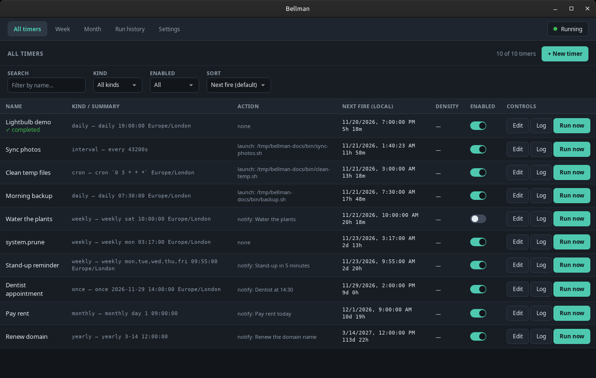

# Bellman

A desktop **task scheduler**, the desktop cousin of cron. Set timers that start
programs, show notifications or wake your own apps, from a simple desktop app or
the `bellman` command line. Named after the bellmen (knocker-uppers) who woke
people before alarm clocks existed: Bellman's job is waking *applications*.

  

  If Bellman saves you time, you can
  <a href="https://buymeacoffee.com/art_tech_guy"><b>buy me a coffee</b></a>.

  

| Platform | State |
|---|---|
| Linux (Debian/Ubuntu, Fedora, Arch) | ✅ works, tested on real hardware |
| macOS on Intel | ✅ works, tested on real hardware |
| macOS on Apple Silicon | 🟡 builds and passes all tests in CI, not yet tried by hand |
| Windows | ⬜ not tested yet (it builds, but nobody has run it on a real PC) |

There is no download yet: build Bellman from source with the install guide for
your system below.

## Guides

- **[Install on Linux](docs/INSTALL_LINUX.md)**: step by step for Debian/Ubuntu, Fedora and Arch
- **[Install on macOS](docs/INSTALL_MACOS.md)**: step by step for Intel and Apple Silicon Macs
- **[What it does](docs/FEATURES.md)**: timers, the CLI, the desktop app and app integration
- **[Connect your own app](docs/INTEGRATION.md#connect-your-own-application)**: let any program be woken by Bellman and report back
- **[Demo apps](testing_apps/README.md)**: the lightbulb examples, to copy or to watch
- **[Your data](docs/LOCAL.md)**: where your timers and logs live (never in this repo)
- **[Screenshots](docs/SCREENSHOTS.md)**: every screen of the app
- **[Development](docs/DEVELOPMENT.md)**: working on Bellman itself (see also [CONTRIBUTING.md](CONTRIBUTING.md))

## License

MIT, see [LICENSE](LICENSE).
