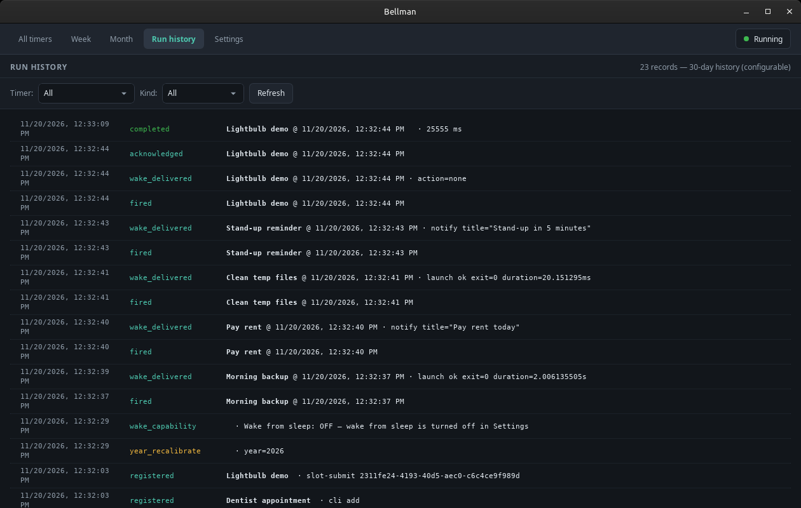

# Bellman screenshots

Back to the [README](../README.md).

## All timers

  

## Week

  

## Month

  

## Run history

  

All product shots live in [`screenshots/`](screenshots/). QA before/after
captures are under [`qa4-screenshots/`](qa4-screenshots/).
