# Bellman screenshots

Back to the [README](../README.md).

Every screen of the desktop app, with sample timers. To take them again, see
[Retaking the screenshots](#retaking-the-screenshots) at the end.

## All timers

Every timer in one list: what it does, when it fires next, and buttons to edit
it, read its log or run it now.

<p align="center">
  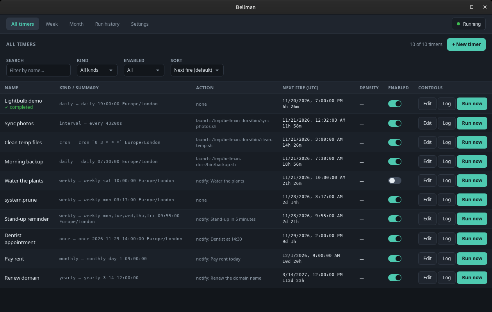
</p>

## A run in progress

When a timer wakes an application, its row shows the run live: here the
lightbulb demo has acknowledged the wake and is still running.

<p align="center">
  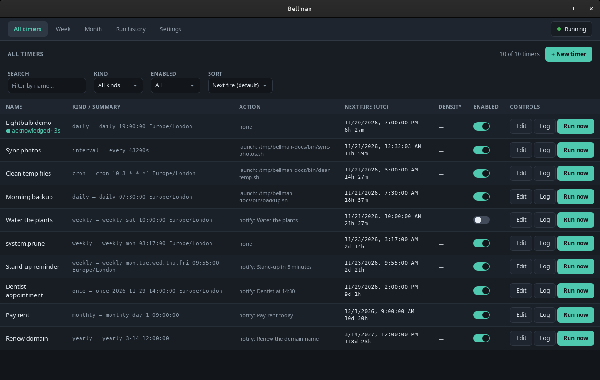
</p>

## Timer log

The Log button opens a timer's latest run and its recent events, from fired
to completed.

<p align="center">
  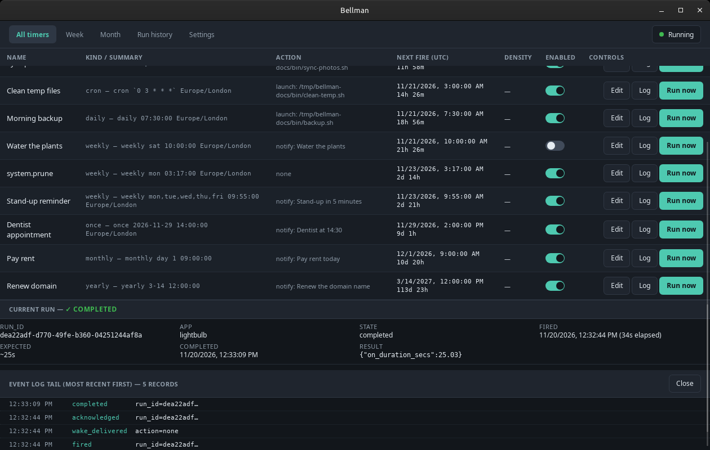
</p>

## New timer

Create a timer: pick how often it repeats, the time and timezone, and what it
does when it fires.

<p align="center">
  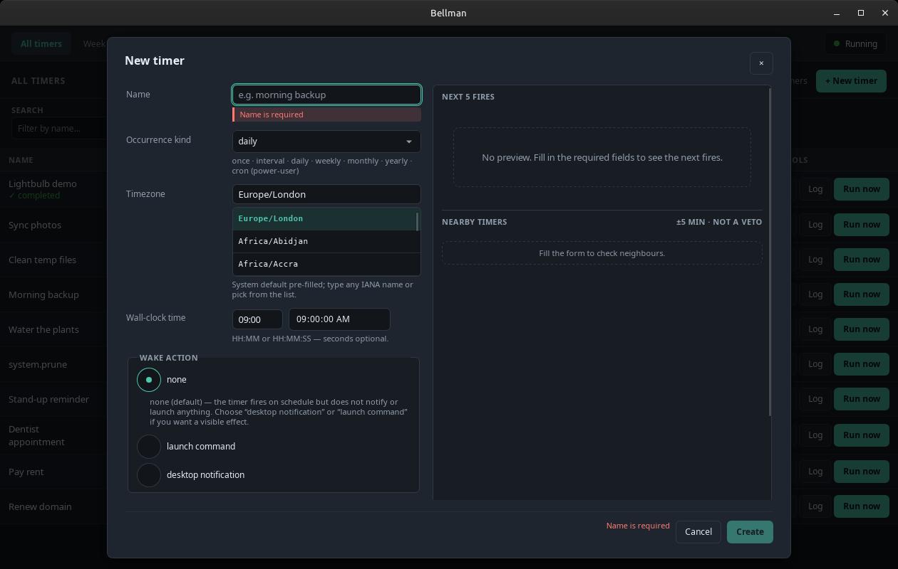
</p>

## Edit timer

Change a timer and check the next five fire times, and any timers that fire
at the same moment, before you save.

<p align="center">
  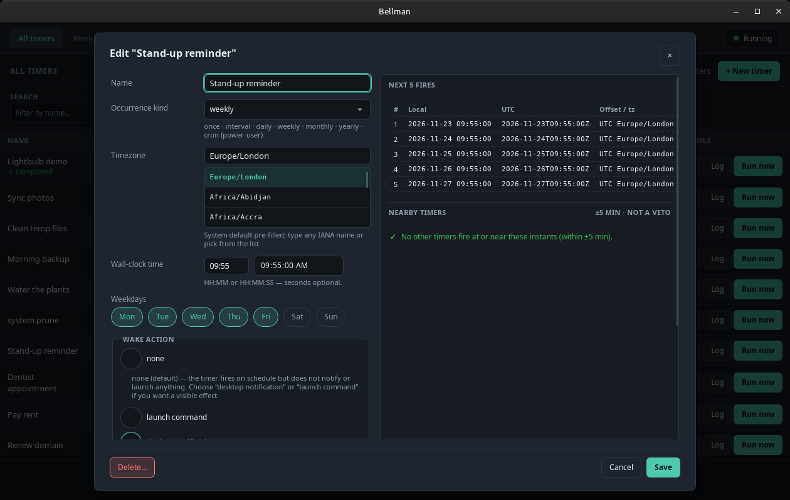
</p>

## Week

The current week, day by day: runs that already happened and the ones still
to come.

<p align="center">
  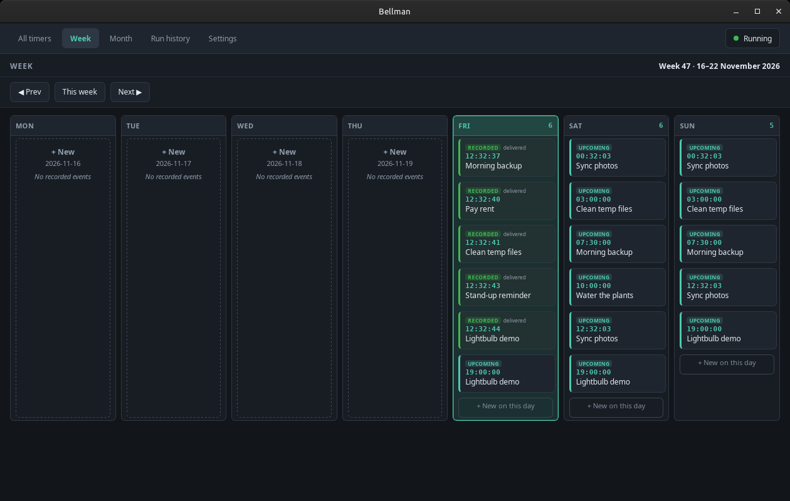
</p>

## Month

A month calendar with each day's runs; click a day to add a timer on it.

<p align="center">
  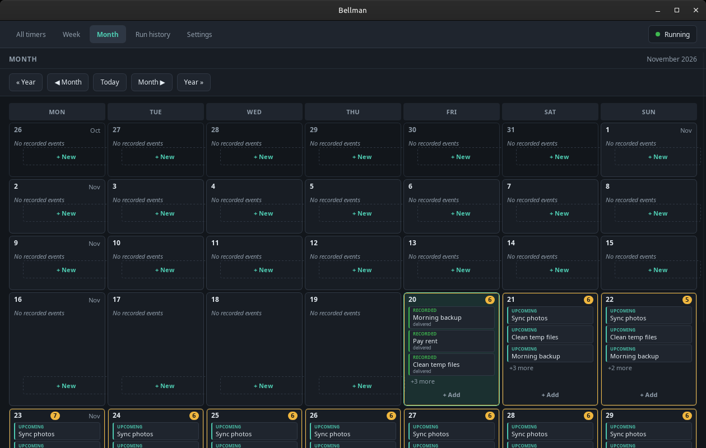
</p>

## Run history

Every event Bellman recorded, newest first, filterable by timer and kind.

<p align="center">
  
</p>

## Settings

Wake from sleep and autostart: how Bellman starts and whether it may wake the
machine.

<p align="center">
  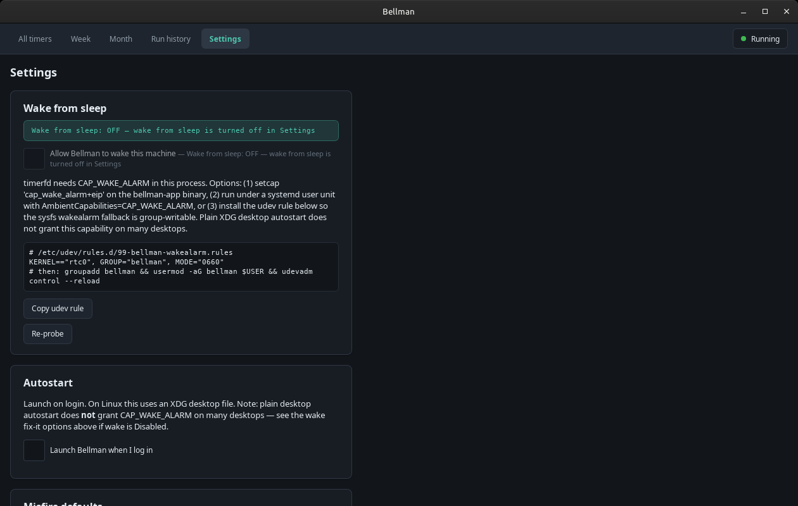
</p>

## Settings, continued

Defaults for missed runs, the engine (including pause all timers), and the
demo.

<p align="center">
  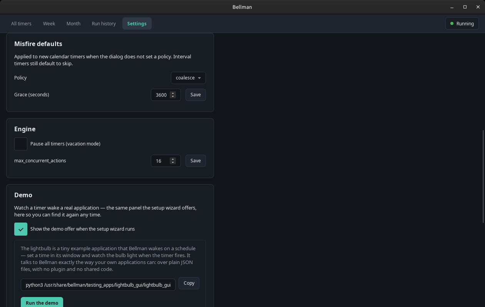
</p>

## Demo

The lightbulb demo: a tiny example app that Bellman wakes on a schedule, and
where Bellman keeps its data.

<p align="center">
  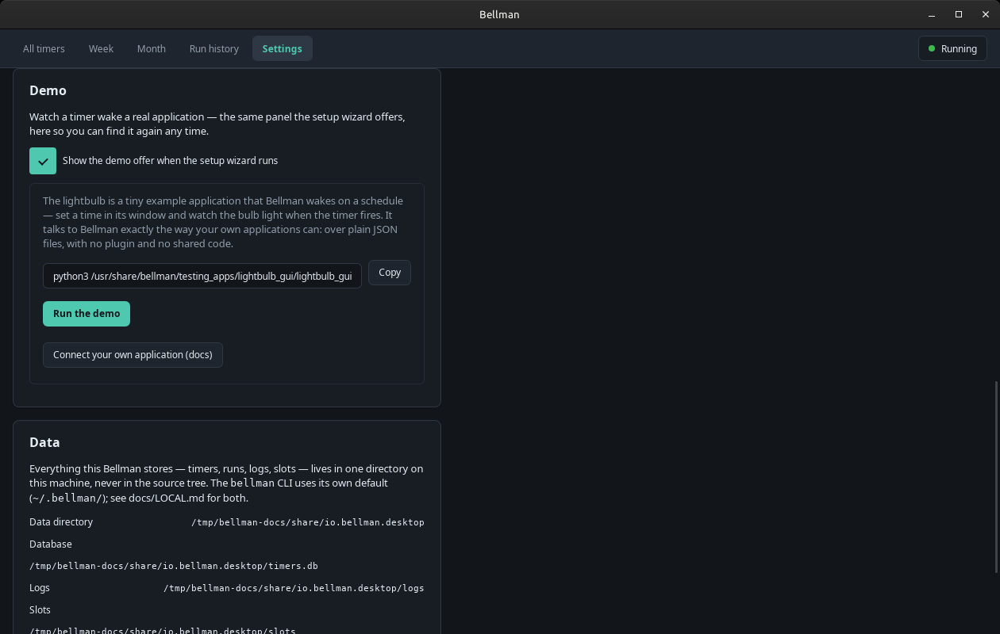
</p>

## First-run wizard: start

The first time Bellman opens it asks a few questions: start at login, start
hidden in the tray, and whether to show the demo.

<p align="center">
  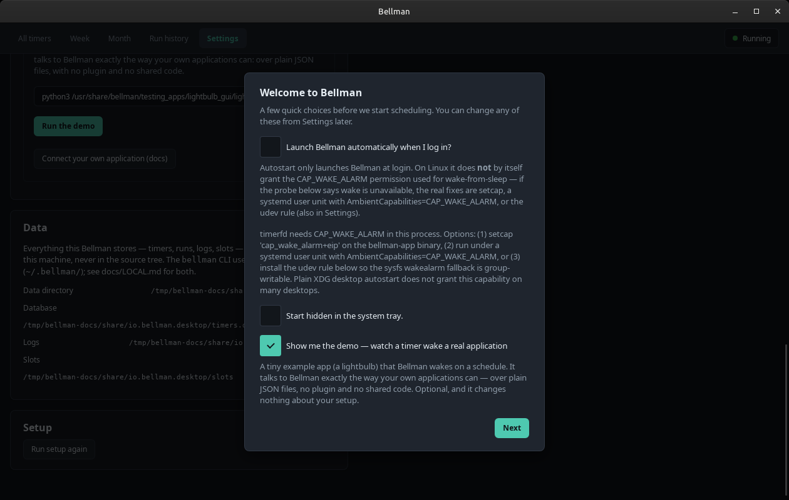
</p>

## First-run wizard: wake from sleep

Choose whether Bellman may wake the machine from sleep so timers fire on time.

<p align="center">
  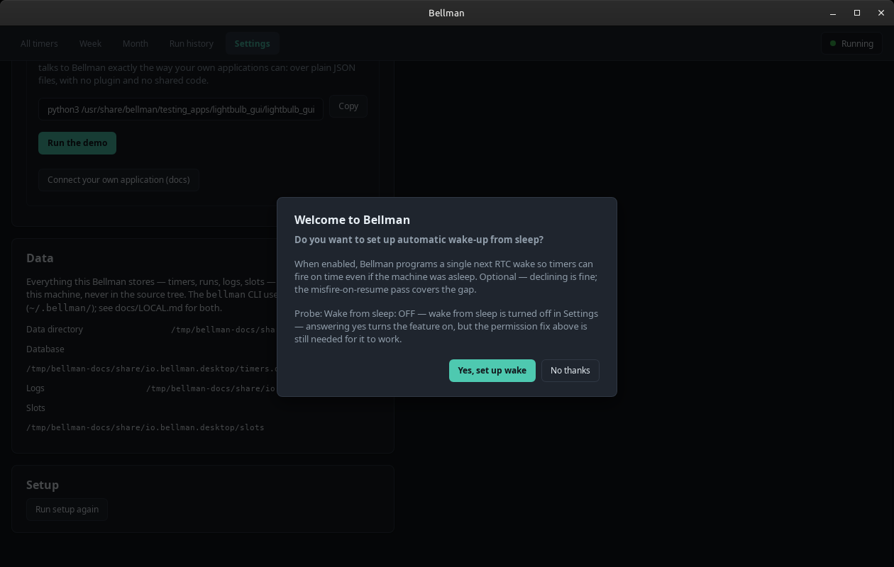
</p>

## First-run wizard: done

A summary: the wake status, a dependency check, and the demo if you asked
for it.

<p align="center">
  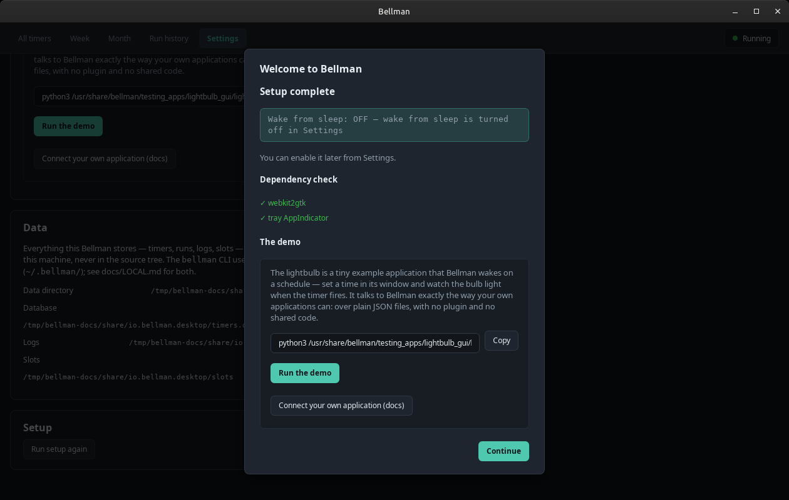
</p>

## Retaking the screenshots

On Linux, with the GUI test prerequisites from
[BUILD_PLAN.md](BUILD_PLAN.md) installed and the app built from this tree
(`cargo tauri build --no-bundle`):

```sh
/tmp/bellman-qa-venv/bin/python scripts/capture_docs_screenshots.py
```

It runs the app on its own hidden display with sample timers in a throwaway
folder, and never touches your own timers. The tray menu is not captured: it
is drawn by the desktop's tray, which the script does not click.

All product shots live in [`screenshots/`](screenshots/). QA before/after
captures are under [`qa4-screenshots/`](qa4-screenshots/).
